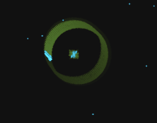
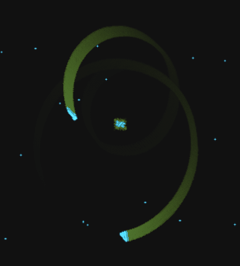

I've been writing games for about forty years. When I sat down with the listing of Spacewar!,
the 1962 PDP-1 game that is one of the first video games ever written, I expected something
charming and primitive. What I found was my own toolkit.

Then I wondered how much faster it could have run on its own machine, with sixty years of
hindsight. The answer: **3.4 times as fast**, from 21 to 71 frames a second, on the 1962
PDP-1, in the same 4,096 words of memory, with no hardware multiply. By the end there is no
multiply, divide or square root left anywhere in the game.

<figure>
<video src="side-by-side.mp4" poster="side-by-side.jpg" width="808" height="440" autoplay muted loop playsinline controls></video>
<figcaption>Twelve seconds of real time on the same emulated PDP-1. Both games start with the ships in
the same orbit and fire at the same moments. Left: 2B as it was in April 1962. Right: with the
changes below. Rendered with Norbert Landsteiner's emulator and its model of the Type 30's
phosphor.</figcaption>
</figure>

## A game programmer opens an ancient artifact

Spacewar! was written at MIT in 1961 and 1962 for a DEC PDP-1: 18-bit words, 4,096 words of
core memory, a 5-microsecond memory cycle, and a round Type 30 display that plots one dot at a
time. Two ships, the Needle and the Wedge, fight around a star that pulls them in. The version I
worked from is 2B, dated 2 April 1962, with the hyperspace and auto-restart patches from that
spring.

Here is what is in it.

**Compiled sprites.** The ships are stored as outline tables: 3 bits per step, each code meaning
"move one dot in this direction". At start-up an *outline compiler* turns each table into
straight-line machine code, a short burst of adds and a display instruction per dot, with no loop
and no table lookups left in it. Halfway through, a special code makes the generated code flip
its rotation matrix and draw the other half of the ship as a mirror image, so only half of each
ship is stored. On the PC in the 1990s we called this a compiled sprite. Spacewar! had it in
1962.

**Hiding work behind the display.** A dot on the Type 30 takes about 50 microseconds, five to ten
instructions' worth of time. Spacewar! never waits for a dot if it can help it. It starts the dot
without waiting (`dpy-4000`), works out where the next one goes, and only then waits for the
display to finish (`ioh`), so the arithmetic is free. Anyone who has set up the next line on a
Vectrex while the beam is still drawing the last one knows this trick.

**Speedcode with a random entry.** The star in the middle is drawn by twenty copies of the same
dot-plotting code (`repeat 20, starp`). Each frame the program jumps into that block at a random
point, so the rays have a random length, then runs it a second time with the signs flipped for
the opposite ray. A hand-unrolled loop with a computed entry, two decades before Duff's device.

**An object system with function pointers.** Every object, from ships and torpedoes to
explosions and ships in hyperspace, lives in one table, and the first word of each slot is the
address of the routine that runs it. The main loop doesn't know what anything is: it calls each
slot's routine. When a ship is hit, the program doesn't set a flag; it overwrites the pointer
with the explosion routine, and the ship *becomes* an explosion. Hyperspace does the same with
another routine. It's the polymorphic game object, decades before most of us met it.

**Real physics in fixed point.** Dan Edwards's gravity pulls both ships toward the star with an
inverse-square force. Velocities and accelerations are fixed-point fractions, and the update is
in the good order: velocity first, then position from the new velocity. That small choice is what
keeps an orbit from spiralling outward. It's the order I stumbled on myself writing a lunar
lander in high school, and Marvin Minsky found it by accident too: his circle algorithm "was
invented by mistake when I tried to save one register in a display hack" (HAKMEM, 1972).

**A scrolling background.** Peter Samson's "Expensive Planetarium" draws the real night sky: 470
stars from a star catalogue, with brightness shown by how often each star is redrawn. The sky
creeps slowly across the screen as you play. It may be the first scrolling background in a game.

It arrived fully formed, more than twenty years before Elite. For the full dig, Norbert
Landsteiner's [*Inside Spacewar!*](https://www.masswerk.at/spacewar/inside/) walks through every
routine, and [his emulator](https://www.masswerk.at/spacewar/) lets you play it. I owe most of my
understanding to him.

## How I got here: a Vectrex

I've been porting Spacewar! 2B to the Vectrex, the 1982 vector console, which draws with a beam
on a phosphor screen much as the Type 30 did. To port a game you have to understand it, and once
I understood it I could see where the time went. 2B runs at about 21 frames a second; on a
Vectrex we aim for 50. So I started asking: how fast could Spacewar! have been on its own machine,
with what we've learned since?

## The rules

1. **The 1962 machine.** The PDP-1 Spacewar! was written for had no hardware multiply or divide.
   Multiplication was a subroutine of multiply-step instructions, hundreds of microseconds a call;
   a sine and cosine cost about 2.35 milliseconds. No later hardware allowed.
2. **4K words.** Everything has to fit in the same 4,096 words of core, next to the star
   catalogue.
3. **It has to feel like 2B.** Not bit-for-bit the same game, but the same game to play: the same
   orbits, the same handling, the same look. Wherever behaviour changed, I measured it against
   the original.

The referee was Landsteiner's emulator, which models the PDP-1's instruction timing, run headless
over 1,500 frames of scripted play. The numbers below are milliseconds per frame with nobody
touching the controls ("idle"), the cleanest case to compare.

## Where the time went

At idle, 2B spends 47.7 milliseconds on each frame. Very little of it is the game you see.

<figure>
<svg class="chart" viewBox="0 0 650 274" role="img" aria-labelledby="chart-t">
<title id="chart-t">Milliseconds per frame, idle, as each optimization is added</title>
<line class="grid" x1="250.0" y1="4" x2="250.0" y2="246"/><text class="axis" x="250.0" y="264" text-anchor="middle">0</text>
<line class="grid" x1="316.0" y1="4" x2="316.0" y2="246"/><text class="axis" x="316.0" y="264" text-anchor="middle">10</text>
<line class="grid" x1="382.0" y1="4" x2="382.0" y2="246"/><text class="axis" x="382.0" y="264" text-anchor="middle">20</text>
<line class="grid" x1="448.0" y1="4" x2="448.0" y2="246"/><text class="axis" x="448.0" y="264" text-anchor="middle">30</text>
<line class="grid" x1="514.0" y1="4" x2="514.0" y2="246"/><text class="axis" x="514.0" y="264" text-anchor="middle">40</text>
<line class="grid" x1="580.0" y1="4" x2="580.0" y2="246"/><text class="axis" x="580.0" y="264" text-anchor="middle">50</text>
<g><title>2B, as of April 1962: 47.71 ms a frame, 21.0 frames a second</title><text class="lab" x="240" y="30.0" text-anchor="end">2B, as of April 1962</text><path class="bar hi" d="M250,15 h310.9 a4,4 0 0 1 4,4 v12 a4,4 0 0 1 -4,4 h-310.9 z"/><text class="val" x="570.9" y="30.0">47.7</text></g>
<g><title>+ Minsky, high-water mark: 29.55 ms a frame, 33.8 frames a second</title><text class="lab" x="240" y="64.0" text-anchor="end">+ Minsky, high-water mark</text><path class="bar" d="M250,49 h191.0 a4,4 0 0 1 4,4 v12 a4,4 0 0 1 -4,4 h-191.0 z"/><text class="val" x="451.0" y="64.0">29.6</text></g>
<g><title>+ squares from a table: 24.28 ms a frame, 41.2 frames a second</title><text class="lab" x="240" y="98.0" text-anchor="end">+ squares from a table</text><path class="bar" d="M250,83 h156.2 a4,4 0 0 1 4,4 v12 a4,4 0 0 1 -4,4 h-156.2 z"/><text class="val" x="416.2" y="98.0">24.3</text></g>
<g><title>+ frozen sky: 19.50 ms a frame, 51.3 frames a second</title><text class="lab" x="240" y="132.0" text-anchor="end">+ frozen sky</text><path class="bar" d="M250,117 h124.7 a4,4 0 0 1 4,4 v12 a4,4 0 0 1 -4,4 h-124.7 z"/><text class="val" x="384.7" y="132.0">19.5</text></g>
<g><title>+ ring gravity: 17.74 ms a frame, 56.4 frames a second</title><text class="lab" x="240" y="166.0" text-anchor="end">+ ring gravity</text><path class="bar" d="M250,151 h113.1 a4,4 0 0 1 4,4 v12 a4,4 0 0 1 -4,4 h-113.1 z"/><text class="val" x="373.1" y="166.0">17.7</text></g>
<g><title>+ 3.1's explosions: 18.16 ms a frame, 55.1 frames a second</title><text class="lab" x="240" y="200.0" text-anchor="end">+ 3.1's explosions</text><path class="bar" d="M250,185 h115.9 a4,4 0 0 1 4,4 v12 a4,4 0 0 1 -4,4 h-115.9 z"/><text class="val" x="375.9" y="200.0">18.2</text></g>
<g><title>+ ships drawn in turn: 13.99 ms a frame, 71.5 frames a second</title><text class="lab" x="240" y="234.0" text-anchor="end">+ ships drawn in turn</text><path class="bar hi" d="M250,219 h88.3 a4,4 0 0 1 4,4 v12 a4,4 0 0 1 -4,4 h-88.3 z"/><text class="val" x="348.3" y="234.0">14.0</text></g>
</svg>
<figcaption>Milliseconds per frame at idle, as each change is added. Shorter is faster: 2B runs at
21 frames a second, the last build at 71.</figcaption>
</figure>

### The empty table

The object table has 24 slots. At idle, two are in use: the two ships. But the main loop walks
all 24, stepping about 21 table pointers for every slot, and the collision test scans every later
slot for each active object. That bookkeeping was 9.4 milliseconds of every frame.

The fix is the oldest trick there is: keep a high-water mark, the highest slot in use, and stop
the loops there. It saved **9.7 ms**, the biggest single win, and the game it plays is identical,
frame for frame.

With the mark in place, the last slot in use can be a ship, and when I flew it the Wedge was
drawn with the Needle's outline: two Needles. Our automated check compared the game state every
frame and passed, because the state was right and only the picture was wrong. From then on, it
compared every dot drawn as well.

### Rotation without trigonometry

Every frame, each ship computes the sine and cosine of its heading so its outline can be drawn
rotated: two calls to a software sine routine, 2.35 ms each, per ship.

But a ship turns by a small fixed step, and Minsky's circle algorithm rotates a point by a small
angle with two shifts and two adds:

```
x = x - (y >> n)
y = y + (x >> n)    ; using the new x
```

Apply it to the rotation matrix when the ship turns, and the per-frame trigonometry goes away.
Saving: **8.4 ms**. The catch is that Minsky's circle is very slightly an ellipse, so the ships
are drawn at 63/64 of their size. Nobody notices.

### Gravity, part one: stop taking square roots

Gravity needs the distance from the star. 2B computes it from scratch every frame for each ship:
two multiplies for x² + y², a 19-step integer square root, another multiply and two divides. The
square root alone was 4.4 ms a frame.

Two observations. Positions here are coarse, cells of 8 dots, so a table of 91 squares covers the
whole screen. And a ship moves at most one ring of distance per frame, so the distance can be
carried over from the last frame and corrected with two compares instead of recomputed. The
result is exactly the same number. Saving: **5.3 ms**, the identical game, and the table fits in
the 128 words 2B's authors left free for patches.

### The frozen sky

The Expensive Planetarium keeps its 470 stars in 936 words, from octal 6077 to the top of memory,
and scrolls one dot every 32 frames. Finding which stars are in the window costs about 130 µs per
star: 5.6 ms a frame.

No one notices the slowly moving stars. The window at the start holds 36 of them; freeze the sky
there, and a 21-word loop draws them in about 0.8 ms on the original brightness schedule. Saving:
**4.8 ms**, and about 840 words of memory freed.

### Gravity, part two: rings

With the distance known, 2B still computes the pull with a multiply and two divides, per ship,
per frame. I wanted to let go of exactness: take the pull from the distance alone, in rings, from
a table. It only has to feel like gravity, and rings around the star should be better than a grid.

To get rid of the last multiply, each ring's pull is a power of two in quarter steps (×1, ×1.25,
×1.5, ×1.75), applied by executing that ring's shift instructions straight out of a table (the
PDP-1's `xct` runs a memory word as an instruction). No multiply, no divide.

It's calibrated to 2B's average pull in each ring, within 7% of 2B over the middle 80% of the
screen. From the idle start, ships fall into the star in 361 frames against 2B's 351. Saving:
**1.8 ms**.

### Drawing one ship per frame

After all that, the biggest cost left was the drawing itself: the two outlines are about 156 dots
a frame at about 50 µs each, 8.5 ms that no clever code can shorten, because it's the display's
own speed.

So draw them in turn: the Needle on even frames, the Wedge on odd ones. At 71 frames a second each
ship is still redrawn about 35 times a second, more often than 2B ever drew them, and the Type
30's long-persistence phosphor carries the image between. Saving: about **4 ms**.

### The last multiply

After ring gravity, only one caller of sine, cosine and the software multiply was left: setting
the ships' headings when a game starts. I replaced all three with CORDIC, the shift-and-add way of
computing sine and cosine together that pocket calculators used.

Ten CORDIC steps give both values from a 10-word table of arctangents. A fixed number of steps has
a fixed gain (0.60725, whatever the angle), so it's paid in advance in the starting vector, along
with Minsky's 63/64. The neat part is the shift. Each step shifts one more bit, and a PDP-1 shift
instruction's count is the number of 1 bits in its low nine bits, so going from a shift of *i* to
*i* + 1 turns those bits *m* into 2*m* + 1. The routine rewrites its own shift instruction that way
every step, and the same instruction is the loop counter: after the shift by nine it carries into
the opcode and the loop ends. Ten steps, because one shift instruction reaches nine.

It's less accurate than 2B's sine, about 1 part in 512, and it doesn't show: the game state is
identical to the build before it, frame for frame, except that torpedoes leave about 0.2% off
in speed. It frees 31 words, and with the square root
and divide routines already gone, **there is no multiply, divide or square root left anywhere in
the game.** It doesn't change the frame rate; it closes the book.

### The small ones

The collision test stores |dx| only after the first reject, and steps only the pointers a
rejected pair needs: about 1 ms, mostly when torpedoes fly, same game.

## The surprises

### The 4K wall

The outline compiler writes its generated code upward from the end of the object tables. When the
table of squares went in among the code, everything above it moved up, and the compiled ships,
about 684 words of them, ran past octal 6077, where the star catalogue begins. The ships wrote
over the stars and the planetarium drew garbage. On a 4K machine there is no "somewhere else". The
fix was the patch space 2B's authors had set aside; later, the frozen sky freed far more room.

### A bug in 2B

While playing, both my ships fell into the star at once, and the game never restarted.

When a ship falls into the star, 2B moves it to the far corner of space (377777, 377777: "now go
bang", says the listing) with no velocity, and explodes it. If both ships fall in during the same
frame, they land on the same spot and collide. 2B never excludes an object that is already
exploding from the collision test, so each explosion restarts the other, every frame, forever. It
reproduces on the unmodified program: ships at (6, 0) and (0, 6), captured at frame 42, still
exploding at frame 600. The same re-arming is why overlapping explosions in 2B sometimes last 30
frames instead of 3.

Spacewar!'s authors found it too. In version 3.1, dated 29 September 1962, an exploding object
gets its sign bit set, the collision scan asks "can it collide?", a captured ship explodes
properly, and explosions last four times as long. My fix is theirs, longer explosions included:
six frames, which costs 0.4 ms but looks right at the higher frame rate.

### Orbits

The question I cared about most: with approximate gravity, does it still play like 2B? The test
was 30 passive orbits, radii from 8 to 22 cells, speeds from 0.75 to 1.0 times circular, two
starting angles, 3,000 frames each, on both builds. In 2B, 15 of the 30 survive; in the optimized
build, 15. Still as tight as they started: 10 in 2B, 12 optimized. Within the chaos of a system
like this, that's a wash.

What changed is how they look. A lap now comes round 3.4 times as fast, and the phosphor
afterglow draws the whole orbit as a ring. In all my years of playing 2B I never got a ship into
orbit; here they are.

<div class="pair">
<figure><figcaption>One ship in orbit.</figcaption></figure>
<figure><figcaption>Both ships, opposite sides of the same orbit.</figcaption></figure>
</div>

## The result

| | 2B | optimized |
|---|---:|---:|
| idle, ms per frame | 47.71 | **13.99** |
| frames per second, idle | 21.0 | **71.5** |
| both ships firing, ms per frame | 66.55 | 26.97 |

**3.4 times as fast**, on the machine it was written for, in the same 4K words, with no multiply,
divide or square root left in it.

One thing to be clear about: Spacewar! moves its ships once per frame, so a faster frame rate makes
the whole game faster, not just smoother. I didn't cap it; we wanted to go faster. But that's the
point of the exercise: the time is there to spend. You could keep 2B's pace and spend it on a
steadier display, more torpedoes, or the moving sky.

## How we did it

I did this with an AI, Claude, and it's worth being specific about who did what.

**The division of labour.** The ideas that changed the game were mine: Minsky rotation, freezing
the sky, ring gravity, drawing the ships in turn, CORDIC for the last sine and cosine, building a
clean base with a real assembler, and not capping the frame rate. I found the two-Needles bug and
the lock-up by playing. Claude wrote all of the PDP-1 code, the tools and the measurements, found
the collision trims and the high-water mark by profiling, and came up with carrying the distance
from frame to frame and the shift-only form of ring gravity. The re-arming fix belongs to
Spacewar! 3.1's authors, in 1962.

**What kept it honest.**

- **A real assembler.** The base is 2B with its patch tapes folded back into source and built
  with macro1, a reimplementation of the 1962 assembler, so a change is an edit, not a patch tape.
  The base plays the identical game to the original tapes, frame for frame.
- **A fingerprint.** Every build runs headless in Landsteiner's emulator core, and every frame the
  object tables and every dot drawn are compared with 2B's. Four of the changes play the
  identical game; the rest were judged by measurement.
- **A profiler**, which pointed at the empty table.
- **My eyes.** Several bugs only showed when I flew the build.

**Where the AI was wrong.** Regularly, and confidently:

- The new star loop drew every star at the same x coordinate, because `idx` leaves its result in
  the accumulator. Caught by comparing dots.
- The first ring gravity fell 6% too slowly: three truncations where 2B's divide has one. Caught by
  timing the fall into the star.
- The compiled outlines overwrote the stars. Caught by the dot fingerprint.
- When the alternating ships flickered in the emulator, it offered three wrong theories before
  measuring. The real bug was in the emulator's JavaScript: a `var k` inside a loop clobbering a
  list of the same name. I saw the flicker; a probe found the cause.
- The first orbit test counted an orbit as kept unless the ship flew past 60 cells, so decaying
  orbits passed. It didn't match what I saw on screen.

The pattern held all the way through: the ideas and the judgement of feel came from playing the
game, and the volume of careful code and measurement came from the machine. Each caught the
other's mistakes.

## Thanks

To Norbert Landsteiner, for the reconstruction of 2B, *Inside Spacewar!* and the emulator that
made all of this measurable; and to Barry Silverman, Brian Silverman and Vadim Gerasimov for the
[original HTML5 emulator](https://spacewar.oversigma.com/html5/).

> Spacewar! was conceived in 1961 by Martin Graetz, Stephen Russell, and Wayne Wiitanen. It was
> first realized on the PDP-1 in 1962 by Stephen Russell, Peter Samson, Dan Edwards, and Martin
> Graetz, together with Alan Kotok, Steve Piner, and Robert A Saunders. Spacewar! is in the public
> domain, but this credit paragraph must accompany all distributed versions of the program.
